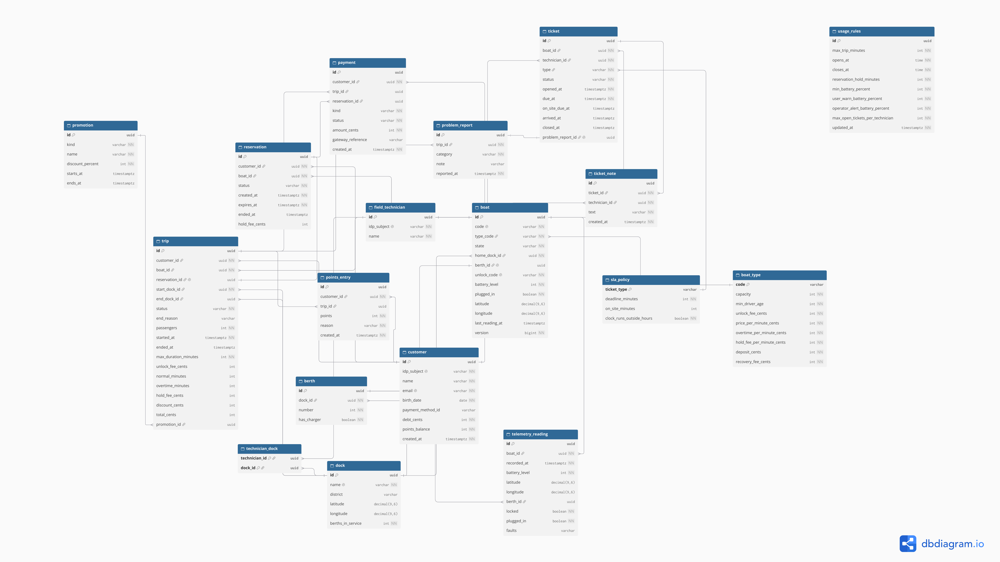

# Barkito: entity-relationship diagram

Logical data model for the PostgreSQL database, derived from the conceptual model of the Product Specification (3.1), the business rules (3.2) and the boat lifecycle (3.3). Table and column names are the ones the JPA entities and the Flyway/SQL scripts should use.

Conventions:

- Primary keys are `UUID`, except for reference tables keyed by their code (`boat_type`, `sla_policy`).
- Money is stored in cents (`*_cents`, integer) so prices never suffer rounding errors.
- Timestamps are `TIMESTAMPTZ` (UTC); domain code reads the time from an injected clock.
- Each module owns its tables (section 4.3). References between modules are plain foreign keys to the other module's `id`, never joins into its internals.
- Accounts with no domain data (operators, client managers, admins) live only in the identity provider and have no table.

The source is [`er-diagram.dbml`](er-diagram.dbml). To update the image, paste it into [dbdiagram.io](https://dbdiagram.io/d) and export it as PNG.

## Tables by module

| Module | Tables | Stories |
|---|---|---|
| Accounts | `customer` | US-01, US-02 |
| Fleet | `boat_type`, `dock`, `berth`, `boat` | US-03 to US-06, US-27 |
| Telemetry | `telemetry_reading` | US-07, US-08 |
| Trips | `reservation`, `trip`, `problem_report` | US-09 to US-15, US-38 |
| Payments | `payment` (debt in `customer.debt_cents`) | US-16 to US-20 |
| Maintenance | `field_technician`, `technician_dock`, `sla_policy`, `ticket`, `ticket_note` | US-21 to US-25, US-28, US-39 |
| Rules | `usage_rules`, `boat_type_rules` (minimum age and prices per boat type) | US-26 |
| Extensions | `promotion`, `points_entry`, `trip_discount` (the points balance is the sum of `points_entry`) | US-33 to US-36 |

## Constraints the database must guard

- `boat.code` and `boat.unlock_code` are unique (US-03, US-12).
- `boat.berth_id` is unique: one boat per berth (BR14).
- `berth (dock_id, number)` is unique.
- A trip ends only in a free berth with `in_service = true` (BR14); the berths in service of a dock are counted, not stored.
- `trip.reservation_id` is unique: a reservation becomes at most one trip.
- `trip_discount.trip_id` is the primary key: at most one discount per trip (BR24).
- At most one active boat per customer (BR3): a partial unique index on `reservation (customer_id) WHERE status = 'ACTIVE'` and on `trip (customer_id) WHERE status = 'IN_PROGRESS'`, checked together with the boat in one transaction.
- `boat.version` is the optimistic lock that lets exactly one of many simultaneous reservations of the same boat succeed (SLO4).

## Names agreed with the class diagram

The class diagram and the code use these names, so entities, DTOs and columns match.

| Topic | Decision | Why |
|---|---|---|
| Berths in service | `Berth.inService` (boolean on each berth); no counter on the dock | US-04: berths are in service by default; BR14 needs to know whether the berth the boat moored in is in service. US-27 sets how many are in service by switching berths. |
| Charger | `Boat.pluggedIn` | BR19 and BR20 say "plugged in"; `CHARGING` is already a boat state. Every berth has a charger, so the berth has no charger flag. |
| Current dock | No `currentDockId`: the dock comes from `berthId` | One source of truth; a boat on the canal has no berth. |
| Battery | `Boat.batteryLevel` | Same name as the telemetry reading. |
| Retirement | `Boat.retirementReason`: IRREPARABLE, LOST, SUNK, STOLEN | US-06: "retire a boat with a reason". |
| Reservation states | ACTIVE, CONVERTED, CANCELLED, EXPIRED | EXPIRED and CANCELLED follow BR8 and BR9; CONVERTED marks the reservation that became a trip. |
| Trip | `status` IN_PROGRESS, ENDED and `endReason` AT_DOCK, ABANDONED, EMPTY_BATTERY, FAULT | The reason drives the charges: BR15 recovery fee, BR16 no towing fee. |
| Payment kinds | DEPOSIT, CAPTURE, RELEASE, HOLD_FEE, RECOVERY_FEE | One row per movement of BR8, BR13 and BR15. |
| Ticket states | OPEN, CLOSED; notes in `TicketNote` | US-22 keeps a ticket open with notes; TOW arrival is `arrivedAt` (US-25). |
| Field Technician | `name`, `idpSubject` | Email and login come from the identity provider; no phone, because no use case needs it and the platform keeps as little personal data as possible. |
| Per-type prices and age | `BoatTypeRules` in the Rules module | Section 4.3: the operator's prices and the municipality's minimum age are rule parameters. `BoatType` keeps the capacity. |
| Discounts and points | `TripDiscount` and `PointsEntry` in the Extensions module | Extensions stay out of the MVP tables. |

