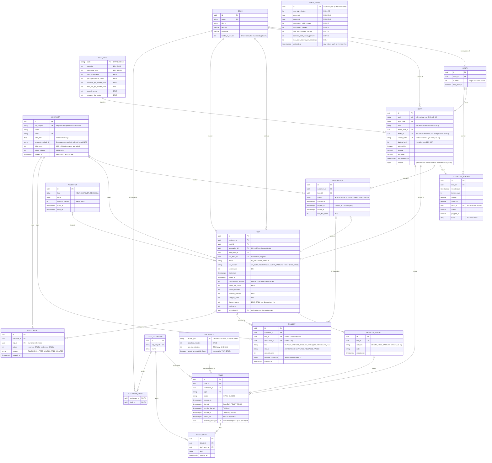

# Barkito: entity-relationship diagram

Logical data model for the PostgreSQL database, derived from the conceptual model of the Product Specification (3.1), the business rules (3.2) and the boat lifecycle (3.3). Table and column names are the ones the JPA entities and the Flyway/SQL scripts should use.

Conventions:

- Primary keys are `UUID`, except for reference tables keyed by their code (`boat_type`, `sla_policy`).
- Money is stored in cents (`*_cents`, integer) so prices never suffer rounding errors.
- Timestamps are `TIMESTAMPTZ` (UTC); domain code reads the time from an injected clock.
- Each module owns its tables (section 4.3). References between modules are plain foreign keys to the other module's `id`, never joins into its internals.
- Accounts with no domain data (operators, client managers, admins) live only in the identity provider and have no table.

## Tables by module

| Module | Tables | Stories |
|---|---|---|
| Accounts | `customer` | US-01, US-02 |
| Fleet | `boat_type`, `dock`, `berth`, `boat` | US-03 to US-06, US-27 |
| Telemetry | `telemetry_reading` | US-07, US-08 |
| Trips | `reservation`, `trip`, `problem_report` | US-09 to US-15, US-38 |
| Payments | `payment` (debt in `customer.debt_cents`) | US-16 to US-20 |
| Maintenance | `field_technician`, `technician_dock`, `sla_policy`, `ticket`, `ticket_note` | US-21 to US-25, US-28, US-39 |
| Rules | `usage_rules` (age and prices per type in `boat_type`) | US-26 |
| Extensions | `promotion`, `points_entry` (balance in `customer.points_balance`) | US-33 to US-36 |

## Constraints the database must guard

- `boat.code` and `boat.unlock_code` are unique (US-03, US-12).
- `boat.berth_id` is unique: one boat per berth (BR14).
- `berth (dock_id, number)` is unique.
- `trip.reservation_id` is unique: a reservation becomes at most one trip.
- At most one active boat per customer (BR3): a partial unique index on `reservation (customer_id) WHERE status = 'ACTIVE'` and on `trip (customer_id) WHERE status = 'IN_PROGRESS'`, checked together with the boat in one transaction.
- `boat.version` is the optimistic lock that lets exactly one of many simultaneous reservations of the same boat succeed (SLO4).
